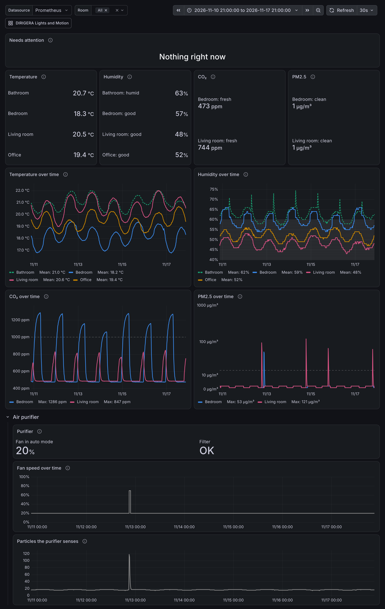
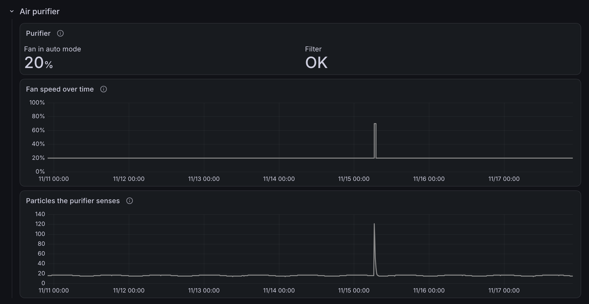
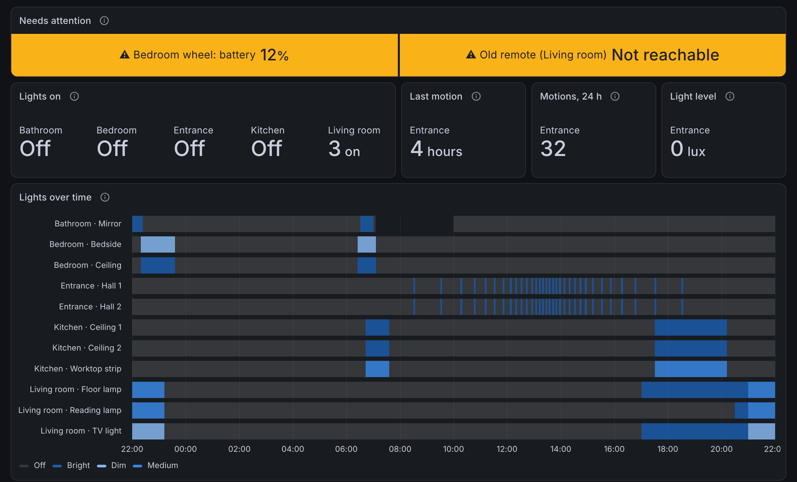

# DIRIGERA Air Quality — Grafana dashboards

Grafana dashboards for [`dirigera-exporter`](https://github.com/Yornik/dirigera-exporter),
scraped by Prometheus:

- `dashboard.json`, **DIRIGERA Air Quality**: air quality from IKEA DIRIGERA
  environment sensors (VINDSTYRKA / ALPSTUGA) and STARKVIND air purifiers.
- `lights-dashboard.json`, **DIRIGERA Lights and Motion**: lights, motion
  sensors and batteries. See [Lights and motion](#lights-and-motion).

<picture>
  <source media="(prefers-color-scheme: light)" srcset="docs/dashboard-light.png">
  
</picture>

## Panels

- **Needs attention:** a full-width strip at the top. It lists only what needs
  you, in plain words with a ⚠ sign: a stuffy room (CO₂ 1000 ppm or more), a
  damp room (70 % or more for an hour), smoke or cooking (PM2.5 35 µg/m³ or
  more), a purifier filter to replace, a purifier that stopped, a sensor with no
  reading, or a hub that stopped answering. Otherwise it says "Nothing right
  now".
- **Now:** one tile each for temperature, humidity, CO₂ and PM2.5, per room,
  with a status word (for example "Bedroom: fresh").
- **History:** temperature, humidity, CO₂ and PM2.5 over time, one color per
  room, with gray reference marks:
  - Temperature: the comfortable band of the selected room (16-19 °C in a
    bedroom, 19-22 °C elsewhere).
  - Humidity: 40-60 %.
  - CO₂: a dashed line at 1000 ppm, "open a window".
  - PM2.5: a dashed line at 15 µg/m³, the WHO 24-hour guideline, on a
    logarithmic scale so cooking peaks do not flatten the everyday level.
- **Air purifier (STARKVIND):** fan mode and speed, the filter state, the fan
  speed over time, and the particles the purifier itself senses, aligned so a
  particle peak sits above the fan boost it causes.
- A `room` template variable to show one room or all.
- A link to the other DIRIGERA dashboard.

### Room colors

In the history charts each room has a color and a line style of its own.
Grafana does not pick a color, so 2 rooms never get similar colors by chance.

`dirigera-exporter` 0.6.0 gives each room a number: 1 for the room with the
oldest device, then 2, and so on. The name of a room is free text and 2 rooms
can have the same icon, so neither tells rooms apart for certain. The number
does. The charts take the rooms that have an air sensor, in the order of their
number:

| Room | Line |
| --- | --- |
| 1st | blue |
| 2nd | pink |
| 3rd | yellow |
| 4th | green, dashed |
| 5th | blue, dashed |
| 6th | pink, dashed |
| 7th | yellow, dashed |
| 8th | green, dotted |
| 9th | blue, dotted |

Blue, pink and yellow are the 3 colors of the palette that stay apart for every
pair of lines, also for a color-blind reader. So the 4th room and up also get
a dashed or a dotted line. A room has the same line in all 4 charts, whatever
the Room filter. A new room gets the highest number, so the other rooms keep
their lines.

With an older exporter, and for a 10th room and up, the line follows the name
of the room: "bed" is blue, "living" pink, "office" yellow, "bath" green and
dashed, and so on. A room with another name is gray.

The temperature and the humidity chart draw the average of each time step.
The charts are 12 columns wide and 10 rows high, close to the golden ratio.

Readings of exactly 0 °C, 0 % or 0 ppm are treated as "no reading" and show as
a gap: the hub reports 0 when a sensor drops out. When the hub stops answering,
the charts show a gap instead of the last value.

The air purifier section. The fan speed sits right above the particles the
purifier senses, so a particle peak lines up with the fan boost it causes:

<picture>
  <source media="(prefers-color-scheme: light)" srcset="docs/purifier-light.png">
  
</picture>

The screenshots use generated test data, not real sensor readings. The data is
composed on the golden ratio, so the week builds up to a focal point at 0.618
of the time range; the header of `tools/testdata.py` lists the rules. To make
them again: load the data of `tools/testdata.py` into an empty Prometheus,
provision both dashboards in a local Grafana that reads it, and take each image
with `tools/screenshot.js`. The header of each file gives the commands.

## Lights and motion

<picture>
  <source media="(prefers-color-scheme: light)" srcset="docs/lights-light.png">
  
</picture>

`lights-dashboard.json` is a separate dashboard. It needs `dirigera-exporter`
0.6.0 or later: the motion counts and the remote presses come from the event
stream of the hub. With 0.5.0 those 3 panels stay empty.

- **Needs attention:** a battery at 15 % or less, a device the hub cannot
  reach, or a hub that stopped answering. Otherwise it says "Nothing right
  now".
- **Now:** how many lights are on in each room, how long ago each motion
  sensor last saw motion, how many motions it saw in the last 24 hours, and
  the light level at the sensor in lux.
- **Lights over time:** one row for each light. Gray is off. Blue is on, and
  darker when brighter.
- **Motion per hour:** times motion started in each hour, as bars. Every
  motion counts, also a short one. It shows when a room is busy.
- **Motion over time:** the moments, one row for each sensor. Zoom in to see
  single moments. Prometheus reads the value every 30 s, so a very short motion
  can be missing in this row.
- **Light level over time.**
- **Remote presses, last 24 h:** presses of each remote control. A turn of a
  scroll wheel is not a press.
- **Batteries and connection:** the battery of each remote control and motion
  sensor now and over time, and when the hub could not reach a device. A light switched off at the wall is not
  reachable.
- The same `room` template variable, and a link to the other dashboard.

Give each light a unique name in its room. Lights with the same name in a room
share 1 row.

## Required metrics

Exported by [`dirigera-exporter`](https://github.com/Yornik/dirigera-exporter):
`ikea_air_temperature_celsius`, `ikea_air_humidity_percent`, `ikea_air_co2_ppm`,
`ikea_air_pm25_micrograms_per_cubic_meter`, and the `ikea_air_purifier_*` series.

The lights dashboard uses `ikea_light_on`, `ikea_light_level_percent`,
`ikea_motion_detected`, `ikea_motion_detections_total`,
`ikea_motion_last_detected_timestamp_seconds`, `ikea_remote_presses_total`,
`ikea_illuminance_lux`,
`ikea_dirigera_device_battery_percent` and `ikea_dirigera_device_reachable`.
Both use `ikea_dirigera_last_success_timestamp_seconds`.

## Import

1. Grafana → Dashboards → New → **Import**.
2. Upload `dashboard.json` or `lights-dashboard.json` (or paste its contents).
3. Select your Prometheus data source.

To provision a dashboard through the kube-prometheus-stack Grafana sidecar, wrap
its JSON file in a `ConfigMap` labelled `grafana_dashboard: "1"`.

## Disclaimer & trademarks

Independent, unofficial project — **not** affiliated with, authorized, sponsored,
or endorsed by Inter IKEA Systems B.V. **IKEA®**, **DIRIGERA**, **STARKVIND**,
**VINDSTYRKA** and **ALPSTUGA** are trademarks of Inter IKEA Systems B.V., used
here solely for identification and descriptive purposes (nominative fair use).

## License

[MIT](LICENSE)
