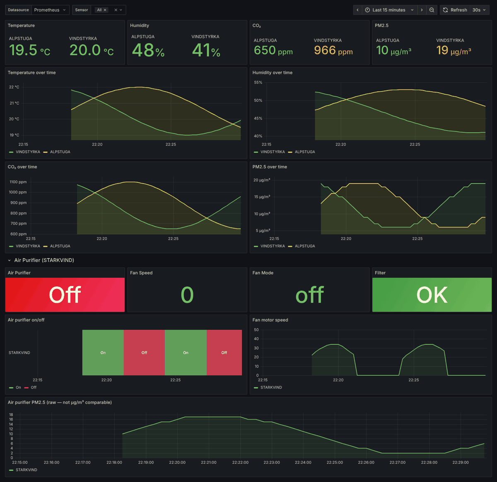
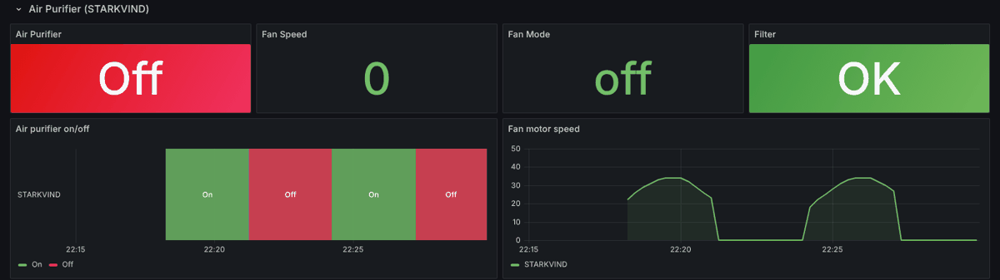

# DIRIGERA Air Quality — Grafana dashboard

A Grafana dashboard for [`dirigera-exporter`](https://github.com/Yornik/dirigera-exporter),
visualising air quality from IKEA DIRIGERA environment sensors (VINDSTYRKA /
ALPSTUGA) and STARKVIND air purifiers, scraped by Prometheus.

<picture>
  <source media="(prefers-color-scheme: light)" srcset="docs/dashboard-light.png">
  
</picture>

## Panels

- **Stat row:** current temperature, humidity, CO₂ and PM2.5.
- **Time series** for each metric, with comfort/quality thresholds:
  - Temperature — blue < 18 °C, green 18–23, red > 23
  - Humidity — comfort band 40–60 %
  - CO₂ — green < 800, amber 800–1200, red > 1200 ppm
  - PM2.5 — green < 15, amber 15–35, red > 35 µg/m³
- **Air Purifier (STARKVIND):** on/off, fan mode, fan speed, filter status, and an on/off timeline.
- A `sensor` template variable to filter by device.

The air purifier section, with the on/off timeline:

<picture>
  <source media="(prefers-color-scheme: light)" srcset="docs/purifier-light.png">
  
</picture>

The screenshots use generated test data, not real sensor readings.

## Required metrics

Exported by [`dirigera-exporter`](https://github.com/Yornik/dirigera-exporter):
`ikea_air_temperature_celsius`, `ikea_air_humidity_percent`, `ikea_air_co2_ppm`,
`ikea_air_pm25_micrograms_per_cubic_meter`, and the `ikea_air_purifier_*` series.

## Import

1. Grafana → Dashboards → New → **Import**.
2. Upload `dashboard.json` (or paste its contents).
3. Select your Prometheus data source.

To provision it through the kube-prometheus-stack Grafana sidecar, wrap
`dashboard.json` in a `ConfigMap` labelled `grafana_dashboard: "1"`.

## Disclaimer & trademarks

Independent, unofficial project — **not** affiliated with, authorized, sponsored,
or endorsed by Inter IKEA Systems B.V. **IKEA®**, **DIRIGERA**, **STARKVIND**,
**VINDSTYRKA** and **ALPSTUGA** are trademarks of Inter IKEA Systems B.V., used
here solely for identification and descriptive purposes (nominative fair use).

## License

[MIT](LICENSE)
